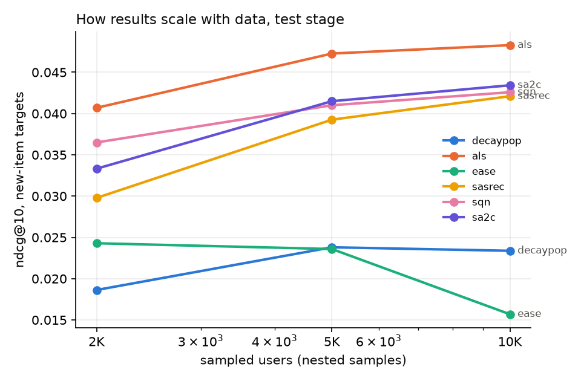
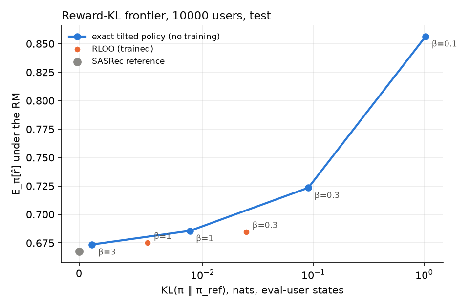

# RL vs standard recommenders on Yambda-50M

All numbers: test week, RTX 5070 Ti. Configs were fixed on the 2K validation week before test was run. The full pipeline was run **twice** with identical code, data and configs (CUDA training is not bit-identical, so run 2 acts as a second training seed). Run 2 is reported below (it adds NDCG@50/@100); run 1 tables are not included. Full tables: `results/v2/tables.md`. Every design choice and why: `DECISIONS.md`.

## 1. Results

### Main table: 10K users (all of Yambda-50M), test week, run 2

Primary metric: **NDCG@10 on new items** (items the user never had before the test week; seen items are filtered from recommendations). Δ = paired bootstrap 95% CI vs SASRec over the same users, `*` = CI excludes 0. 7,075 users with new-item targets, 5,213 with organic new-item targets.

| Group | Model | NDCG@10 new | NDCG@50 new | NDCG@100 new | Δ@10 vs SASRec | Δ@100 vs SASRec | Recall@100 new | Cov@10 new | NDCG@10 organic new | NDCG@10 all |
|---|---|---|---|---|---|---|---|---|---|---|
| Heuristics | MostPop | 0.0128 | 0.0138 | 0.0169 | −0.029* | −0.039* | 0.026 | 0.0005 | 0.0082 | 0.053 |
| | DecayPop (half-life 7d) | 0.0234 | 0.0264 | 0.0320 | −0.019* | −0.024* | 0.053 | 0.0003 | 0.0198 | 0.060 |
| | Recently played | — | — | — | — | — | — | — | — | **0.374** |
| Co-occurrence / CF | ItemKNN (cosine) | 0.0290 | 0.0271 | 0.0305 | −0.013* | −0.025* | 0.042 | **0.105** | 0.0088 | 0.133 |
| | Co-visitation (sequential) | 0.0107 | 0.0124 | 0.0157 | −0.031* | −0.040* | 0.027 | 0.161 | 0.0090 | 0.127 |
| | EASE (top 20K items) | 0.0157 | 0.0281 | 0.0367 | −0.026* | −0.019* | 0.067 | 0.018 | 0.0078 | 0.287 |
| | **ALS** | **0.0483** | **0.0540** | **0.0652** | **+0.006*** | **+0.010*** | **0.103** | 0.037 | **0.0205** | 0.148 |
| Neural, supervised | Two-tower (2K only) | 0.0220 @2K | 0.0245 @2K | 0.0300 @2K | — | — | 0.048 @2K | 0.035 | 0.0093 @2K | 0.136 @2K |
| | SASRec (feedback-aware tokens) | 0.0421 | 0.0465 | 0.0555 | — | — | 0.086 | 0.052 | 0.0173 | 0.184 |
| RL A: offline Q-learning | SQN (CE + TD) | 0.0426 | 0.0467 | 0.0562 | +0.0005 | +0.0007 | 0.088 | 0.040 | 0.0183 | 0.170 |
| | SA2C (advantage-weighted CE) | 0.0434 | 0.0466 | 0.0554 | +0.0013 | −0.0001 | 0.086 | 0.041 | 0.0168 | 0.169 |
| | Q head only (SQN) | 0.0010 | — | — | −0.041* | — | 0.003 | 0.021 | 0.0003 | 0.005 |
| RL B: KL-regularised | RLOO β = 1 | 0.0418 | 0.0462 | 0.0554 | −0.0003 | −0.0000 | 0.087 | 0.051 | 0.0171 | 0.185 |
| | RLOO β = 0.3 | 0.0409 | 0.0459 | 0.0549 | — | — | 0.086 | 0.049 | 0.0163 | 0.185 |
| | Tilted policy β = 1 (no training) | 0.0417 | 0.0462 | 0.0552 | −0.0004 | −0.0003 | 0.086 | 0.051 | 0.0168 | 0.185 |
| | Tilted policy β = 0.3 | 0.0398 | 0.0442 | 0.0529 | — | — | 0.083 | 0.050 | 0.0160 | 0.183 |
| | Tilted policy β = 0.1 | 0.0227 | 0.0287 | 0.0363 | — | — | 0.061 | 0.036 | 0.0101 | 0.136 |

Deeper cutoffs change little: the order at NDCG@100 is the same as at @10 for the top models, ALS's lead grows (+0.010 at @100), and EASE recovers somewhat at depth (its top-20K-item restriction hurts most at the top of the list).

### Run-to-run stability (run 1 vs run 2, NDCG@10 new, Δ vs SASRec of the same run)

| | 2K run 1 | 2K run 2 | 5K run 1 | 5K run 2 | 10K run 1 | 10K run 2 |
|---|---|---|---|---|---|---|
| SASRec (absolute) | 0.0344 | 0.0298 | 0.0385 | 0.0393 | 0.0407 | 0.0421 |
| ALS − SASRec | +0.006* | +0.011* | +0.009* | +0.008* | +0.008* | +0.006* |
| SQN − SASRec | +0.002 | +0.007* | +0.003* | +0.002 | +0.003* | +0.001 |
| SA2C − SASRec | −0.000 | +0.004 | +0.003* | +0.002 | +0.002* | +0.001 |
| RLOO β=1 − SASRec | −0.001* | +0.000 | +0.000 | +0.000 | +0.000 | −0.000 |

The CIs only cover user sampling. SASRec itself moves by up to 0.005 between runs, which is the size of the RL A effect, so RL A's per-run significance does not survive a second seed. ALS's lead and the RL B conclusions do.

### How it scales: NDCG@10 new, test week, run 2



| Model | 2K | 5K | 10K |
|---|---|---|---|
| ALS | 0.0407 | 0.0473 | 0.0483 |
| SA2C | 0.0333 | 0.0415 | 0.0434 |
| SQN | 0.0365 | 0.0410 | 0.0426 |
| SASRec | 0.0298 | 0.0393 | 0.0421 |
| ItemKNN | 0.0260 | 0.0288 | 0.0290 |
| DecayPop | 0.0186 | 0.0238 | 0.0234 |
| EASE (20K items) | 0.0243 | 0.0236 | 0.0157 |

### RL B: reward-KL frontier (RM reward vs distance from SASRec), run 2



| 10K test | KL to SASRec | E[r̂] under RM | NDCG@10 new |
|---|---|---|---|
| SASRec (reference) | 0 | 0.667 | 0.0421 |
| RLOO β = 1 | 0.006 | 0.675 | 0.0418 |
| Tilted β = 1 | 0.009 | 0.686 | 0.0417 |
| RLOO β = 0.3 | 0.025 | 0.685 | 0.0409 |
| Tilted β = 0.3 | 0.090 | 0.723 | 0.0398 |
| Tilted β = 0.1 | 1.031 | 0.857 | 0.0227 |

### Reward model and judge quality (held-out test-week listens, 10K)

| Predictor | Spearman | AUC listen+ | **Within-user AUC** |
|---|---|---|---|
| Reward model (RL B) | 0.410 | 0.807 | **0.680** |
| User's mean reward | 0.323 | 0.745 | 0.498 |
| Item's mean reward | 0.159 | 0.620 | 0.562 |
| CatBoost judge | 0.356 | 0.769 | — |

Within-user AUC of the RM by sample size (run 1): 0.632 (2K) → 0.655 (5K) → 0.677 (10K).

### RL C: exploration simulator (toy, RM = "true" user), 10K, run 2

| Policy | Mean true reward / rec | Items covered |
|---|---|---|
| SASRec prior only | 0.677 | 54,835 |
| Greedy (learns item offsets) | 0.695 | 51,360 |
| ε-greedy (0.1) | 0.697 | 44,709 |
| UCB | 0.690 | **69,182** |
| Thompson sampling | 0.674 | 41,938 |
| Oracle (knows RM) | 0.781 | 47,000 |

## 2. Problem statement

**Task.** For each user at a fixed moment, recommend 10 tracks for the next 7 days. Data: Yambda-50M listens (10K users, 46.5M listens, 301 days) with played ratio, likes, dislikes and an organic flag.

**Why RL at all.** Next-item models (SASRec) imitate logged behaviour: a track skipped after 5 seconds and a track listened to the end and liked are the same "next item". The logs carry a reward signal that imitation ignores, so the question is whether optimising that reward offline gives better recommendations than imitation and than standard collaborative filtering.

**MDP.** State = last 200 events (item, feedback class, organic flag). Action = next item. Reward of an event: skip (played < 50%) 0, listen+ 1, like 2, dislike −1. Policy = softmax over the item vocabulary.

**Constraint: offline only.** No environment, no logging propensities. Any policy improvement must stay close to what the logs support, and any claimed improvement must be checked by more than one offline signal.

**Evaluation protocol.**
- Global time split `train | 1d gap | val 7d | 1d gap | test 7d`. Val is for choices only; for test, every model is refit on everything before the second gap. Gaps mimic a model fitted tonight serving tomorrow and stop session continuation from inflating scores.
- Nested user samples 2K ⊂ 5K ⊂ 10K to see how conclusions change with data.
- Three target sets: **all** listen+ items (dominated by re-listens), **new** items (primary; discovery is where models differ), **organic new** items (found by the user without a recommendation, so less tied to the old recommender).
- NDCG at 10, 50 and 100 (ideal DCG over min(|targets|, k)); paired bootstrap CIs over users; two full runs for training variance; RM and judge checked against item-mean and user-mean baselines; an independent CatBoost judge scores every list.

## 3. System schema

```mermaid
flowchart LR
  subgraph Data
    L[Yambda listens<br/>played_ratio, organic] --> E[Events with feedback class<br/>skip / listen+ / like / dislike]
    LK[likes / dislikes<br/>join within 30 min] --> E
    E --> S[Time split<br/>train - gap - val - gap - test]
  end
  subgraph Candidates and baselines
    S --> CF[Pop, Recent, ItemKNN,<br/>Co-visit, EASE, ALS]
    S --> TT[Two-tower]
  end
  subgraph Sequential policy
    S --> ENC[Causal transformer<br/>tokens = item + feedback + organic]
    ENC --> CE[CE head: SASRec<br/>next listen+ item]
    ENC --> Q[Q head: SQN / SA2C<br/>TD loss on all transitions]
  end
  subgraph RL B
    S --> RM[Reward model<br/>E reward given state, item]
    CE --> REF[pi_ref]
    REF --> TILT[Tilted policy<br/>pi_ref x exp r/beta]
    RM --> TILT
    REF --> RLOO[RLOO + exact KL]
    RM --> RLOO
  end
  subgraph Evaluation
    CF --> EV[NDCG@10/50/100, Recall, Reward@10<br/>all, new, organic new]
    TT --> EV
    CE --> EV
    Q --> EV
    TILT --> EV
    RLOO --> EV
    J[CatBoost judge<br/>point-in-time features] --> EV
    RM --> SIM[Bandit simulator<br/>greedy, eps, UCB, Thompson]
  end
```

Production view: CF models and SASRec act as candidate generators (Recall@100), the RL-trained heads or a reranker order the candidates, and online exploration (RL C) is what would let the system learn about items the logs never showed.

## 4. Main idea and what we found

**Three RL directions, three questions.**

1. **RL A: use feedback as reward inside the sequential model (SQN, SA2C).** A Q head on the SASRec encoder is trained with a TD loss on every transition, including skips and dislikes; SQN keeps it as an auxiliary task, SA2C reweights the CE loss by the Q-advantage.
   - **A small, consistent-in-sign gain that is not robust to retraining.** SQN/SA2C are ahead of SASRec in 11 of 12 comparisons (2 methods × 3 sizes × 2 runs), on average about +0.002 NDCG@10 new (~5% relative). In run 1 the gain was significant at 5K and 10K; in run 2 only SQN at 2K was significant. SASRec's own run-to-run change is of the same size, so the honest claim is "likely a small positive effect, not established with 2 seeds".
   - Stable trade-off in both runs: catalogue coverage drops (0.052 → 0.040) and NDCG on all items drops (0.184 → 0.170). The reward pushes towards "safe" items the user is likely to finish.
   - The Q head alone ranks badly (NDCG 0.001): Q values are only grounded on logged actions. It is useful as a training signal, not as a ranker.
2. **RL B: optimise a learned reward with a KL leash (RLOO vs the exact tilted policy).** For a one-step reward and an RM that scores every item at once, the optimum of E[r̂] − β·KL(π‖π_ref) is π_ref·exp(r̂/β), computable without training.
   - **RLOO lands below this closed-form frontier** at every sample size and in both runs (10K run 2: RLOO β = 0.3 reaches E[r̂] 0.685 at KL 0.025; the tilted policy reaches 0.686 at KL 0.009). Interpolating the frontier, RLOO captures roughly 45–70% of the available reward gain at its KL. Training buys nothing the closed form doesn't give.
   - **The RM reward is gameable**: at β = 0.1 the RM reward rises from 0.667 to 0.857 while NDCG new halves and the independent judge does not move (0.649 → 0.649). Small KL keeps relevance; large reward gains are reward hacking.
   - RM quality matters most: overall AUC 0.81 looks good, but a constant "this user skips a lot" baseline already gets 0.75. Within one user the RM ranks items at 0.68 AUC (item popularity: 0.56). That is the part a policy can use, and it grows with data.
3. **RL C: exploration (toy simulator).** With the RM as the world and SASRec as the agent's prior, learning shared item offsets online gives +0.02 true reward per recommendation over the prior (greedy / ε-greedy); UCB explores most (+26% items covered) at a small reward cost; Thompson sampling with this short horizon does worse than the prior. All are far from the oracle (0.78), because the SASRec prior is almost uncorrelated with the RM inside each user's pool (corr ≈ 0.02): item-level learning cannot recover per-user taste. Same picture in both runs.

**Standard models remain strong.**
- **ALS is the best model for new items at every sample size, at every cutoff (@10/@50/@100) and in both runs** (+0.006–0.011 NDCG@10 over SASRec, +0.010 at @100 on 10K), and on organic new items. Sequential models win on "what next", factorisation wins on "what new".
- On **organic** new items, SASRec's lead over popularity disappears (DecayPop 0.0198 vs SASRec 0.0173 at 10K, run 2): part of what sequence models learn on new items is predicting what the old recommender pushed. RL A's edge here is within noise (SQN +0.0010, SA2C −0.0005).
- On **all** items, "recently played" wins by far (0.374): music is mostly re-listening.
- EASE degrades with scale at the top of the list (0.024 → 0.016 NDCG@10 at 10K) because it is restricted to the 20K most popular items while the vocabulary grows to 338K; at @100 it partly recovers.

**Answer to "can RL beat standard methods offline?"** Inside the sequential family, RL A probably adds a small amount (+~5% relative) at a coverage cost, but two runs are not enough to establish it. Against the best standard model for discovery (ALS), no. Reward-model RL (RL B) is bounded by the closed-form tilt and by RM quality; offline it cannot be shown to help, and beyond small KL it hacks the RM. Defensible next steps: more seeds for RL A, RL A on top of a stronger candidate set (ALS + SASRec/SQN hybrid), and per-user exploration validated online.

## 5. Limitations

- Two full runs (effectively two training seeds); bootstrap CIs cover user sampling only. Effects of the size of RL A (~0.002 NDCG) need ≥ 5 seeds to settle.
- 6,000 steps for every neural model (losses still decreasing slowly); hyperparameters tuned only lightly on 2K val.
- Rewards and the RM/judge are conditional on an item being played: they cannot score items the user would never open.
- Likes are attached to a listen only within 30 minutes (0.7% of listens), so reward is mostly listen+ vs skip.
- No logging propensities in Yambda, so no IPS / doubly robust off-policy evaluation; the bandit is a simulator of the RM, not of users.
- Two-tower was run only at 2K (clearly behind on val).
